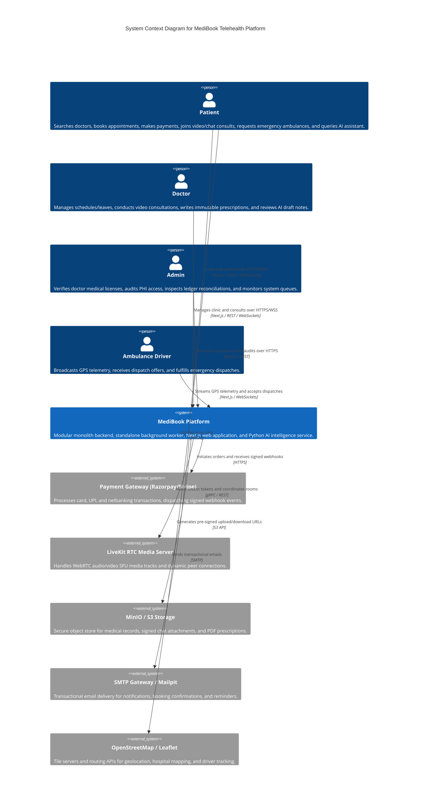
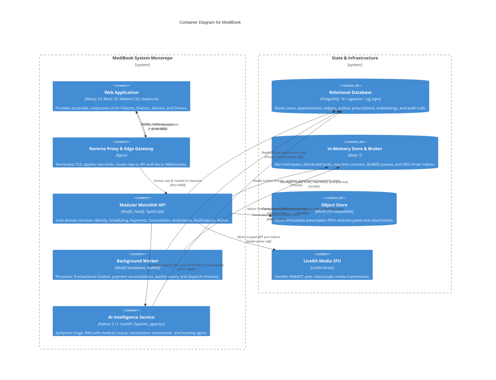
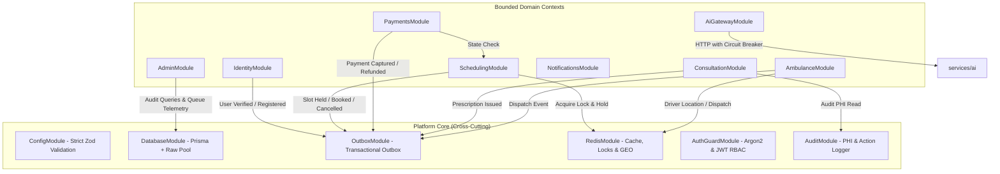
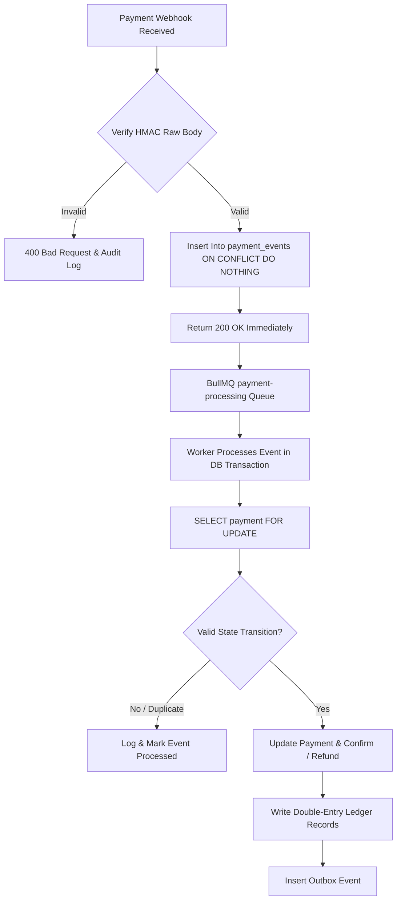
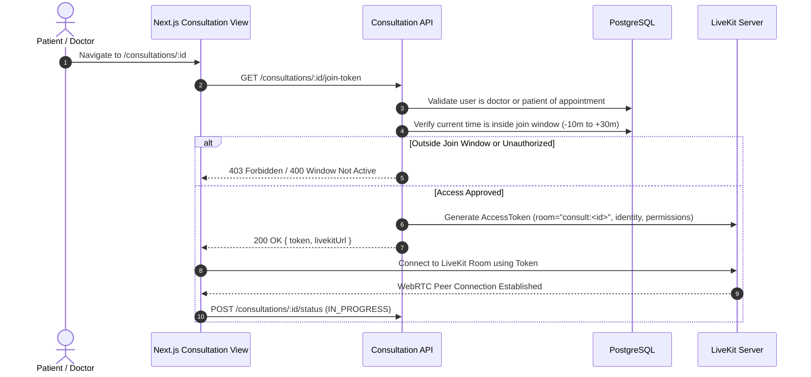
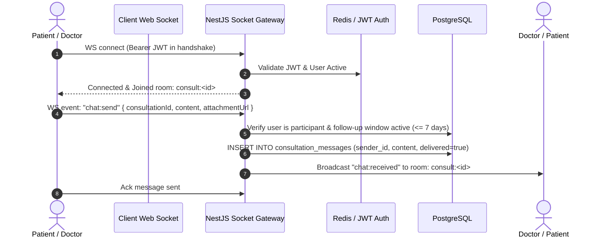
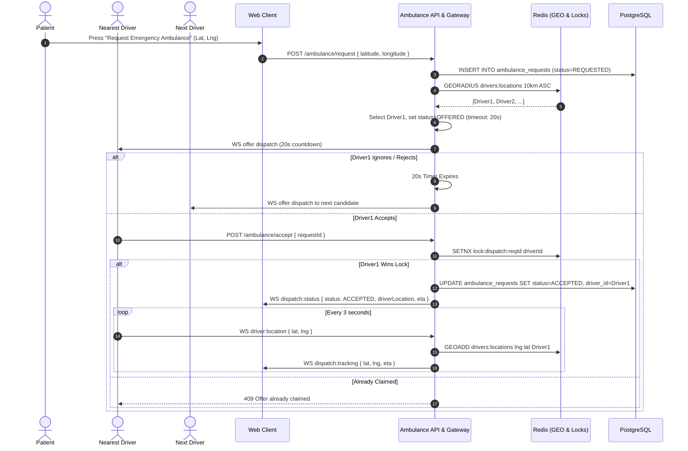
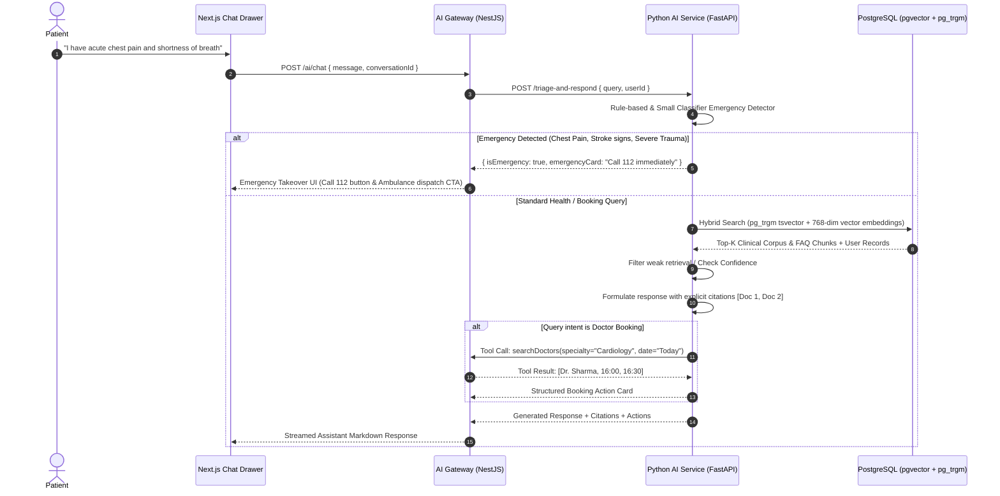

# MediBook Architecture Specification (C4 Model & Data Flows)

## 1. System Overview
MediBook is a production-grade, secure, and resilient telehealth platform designed to handle real-world clinical and emergency workflows. It bridges patients, medical practitioners, emergency responders, and clinic administrative staff through a low-latency, modular monolithic architecture.

---

## 2. C4 Context Diagram (System Context)



---

## 3. C4 Container Diagram



---

## 4. Module Map (NestJS Modular Monolith)

Inside `apps/api/src/modules/`, modules interact strictly via exported interface contracts and domain events. No cross-module database table access is allowed.



---

## 5. End-to-End Data Flows

### 5.1 Booking & Payment Flow (Hold -> Razorpay -> Webhook -> Confirm)
```mermaid
sequenceDiagram
  autonumber
  actor Patient
  participant Web as Next.js Web
  participant API as Scheduling / Payments API
  participant Redis as Redis (Holds & Locks)
  participant DB as PostgreSQL (Prisma)
  participant RZ as Razorpay Provider
  participant Worker as Background Worker

  Patient->>Web: Select Doctor & Slot (Asia/Kolkata)
  Web->>API: POST /appointments/hold (doctorId, slotTime)
  API->>Redis: SET slot:hold:docId:slotTime (patientId, NX, EX 600)
  alt Slot already held or booked
    Redis-->>API: Nil (Already Held)
    API-->>Web: 409 Conflict (Slot Unavailable)
  else Slot Hold Acquired
    Redis-->>API: OK
    API-->>Web: 200 OK (holdToken, expiresAt)
    Patient->>Web: Proceed to Checkout
    Web->>API: POST /payments/create-order (holdToken, amountPaise)
    API->>RZ: Create Order (amount, currency="INR", receipt)
    RZ-->>API: order_id
    API->>DB: INSERT INTO payments (status=PENDING, order_id, slot_hold)
    API-->>Web: 200 OK (order_id, razorpay_key, amount)
    Patient->>RZ: Complete UPI / Card Payment
    RZ->>API: POST /payments/webhook (raw HMAC signature)
    API->>API: Verify HMAC signature
    API->>DB: INSERT INTO payment_events (event_id, payload) ON CONFLICT DO NOTHING
    API-->>RZ: 200 OK (Fast Ack)
    Worker->>DB: Read pending payment_events
    Worker->>DB: BEGIN TX; SELECT * FROM payments FOR UPDATE;
    Worker->>DB: Check slot hold validity & transition payment to CAPTURED
    Worker->>DB: INSERT INTO appointments (status=CONFIRMED, booking_ref)
    Worker->>DB: INSERT INTO ledger_entries (double-entry balancing)
    Worker->>DB: INSERT INTO outbox_events (AppointmentConfirmed)
    Worker->>DB: COMMIT TX
    Worker->>Redis: DEL slot:hold:docId:slotTime
    Worker->>API: Outbox relay triggers Socket.io notification to Patient & Doctor
  end
```

### 5.2 Asynchronous Webhook Processing Flow


### 5.3 LiveKit Video Join Flow


### 5.4 Consultation Chat Message Flow


### 5.5 Emergency Ambulance Dispatch Flow


### 5.6 AI Assistant Request (Triage + RAG + Tool Calling)

