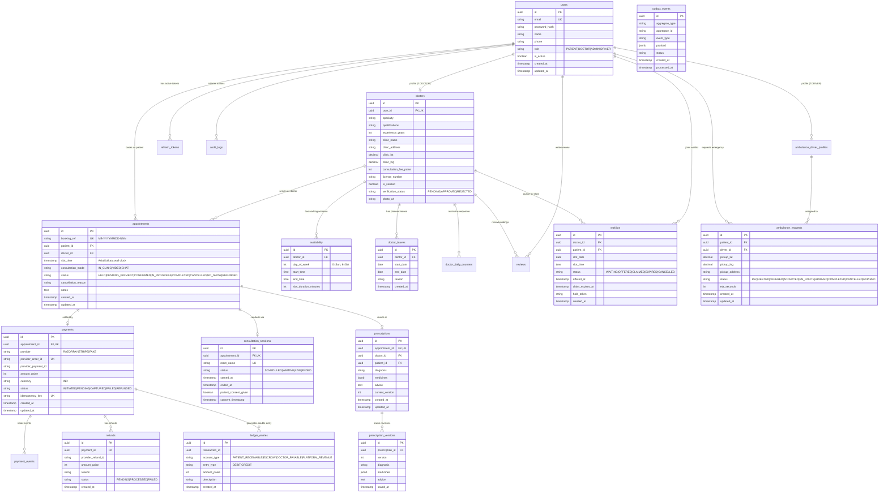

# MediBook Domain Model & State Machines

## 1. Entity Relationship Diagram (ERD)



---

## 2. State Machines and Transition Tables

### 2.1 Appointment Lifecycle State Machine
Appointments progress from initial slot acquisition through payment confirmation, clinical consultation, to completion or exit states.

```
       [Slot Held] (Redis TTL)
            │
            ▼
    ┌────────────────┐
    │ PENDING_PAYMENT│─────────────┐
    └───────┬────────┘             │
            │ Payment Captured     │ Payment / Hold Expired
            ▼                      ▼
    ┌────────────────┐     ┌───────────────┐
    │   CONFIRMED    │     │   CANCELLED   │
    └───────┬────────┘     └───────────────┘
            │ Consultation Starts  ▲
            ▼                      │ Doctor / Patient Cancel
    ┌────────────────┐             │ (triggers refund if paid)
    │  IN_PROGRESS   │             │
    └───────┬────────┘             │
            │ Doctor Completes     │
            ▼                      │
    ┌────────────────┐             │
    │   COMPLETED    │             │
    └────────────────┘             │
            │                      │
            ▼                      │
    ┌────────────────┐             │
    │    NO_SHOW     │─────────────┘
    └────────────────┘
```

| Current Status | Allowed Next Status | Triggering Event / Action | Side Effects / Invariants |
| :--- | :--- | :--- | :--- |
| `HELD` (in-memory) | `PENDING_PAYMENT` | Checkout order initialized | Payment row created; Redis hold lease locked. |
| `PENDING_PAYMENT` | `CONFIRMED` | Webhook verified `payment.captured` | Generate daily reference `MB-YYYYMMDD-NNN`, release hold, emit Outbox event. |
| `PENDING_PAYMENT` | `CANCELLED` | Order expired (10 min) or user cancels | Delete Redis hold; slot freed for other patients. |
| `CONFIRMED` | `IN_PROGRESS` | Doctor/Patient enters live consult | Consultation session moved to `LIVE`. |
| `CONFIRMED` | `CANCELLED` | Doctor or Patient initiates cancellation | Determine refund tier (>24h full, <24h partial); emit refund job; trigger waitlist offer chain. |
| `CONFIRMED` | `NO_SHOW` | Patient does not join within 30 min | Close session without refund; mark slot freed. |
| `IN_PROGRESS` | `COMPLETED` | Doctor clicks "End Visit & Issue Rx" | Doctor may now issue formal prescription; session closed. |
| `COMPLETED` | `REFUNDED` | Admin dispute approval | Reverses ledger entries via compensation credit/debit. |

---

### 2.2 Payment State Machine
Governs all customer payments initiated via Razorpay/Stripe.

| Current Status | Allowed Next Status | Triggering Event | Ledger Invariant |
| :--- | :--- | :--- | :--- |
| `INITIATED` | `PENDING` | Order created at payment gateway | No ledger entry yet. |
| `PENDING` | `CAPTURED` | Valid gateway webhook `payment.captured` | Debit `PATIENT_RECEIVABLE`, Credit `ESCROW`. Balance = 0. |
| `PENDING` | `FAILED` | Gateway webhook `payment.failed` | No ledger entry. |
| `CAPTURED` | `SETTLED` | Consultation marked `COMPLETED` | Debit `ESCROW`, Credit `DOCTOR_PAYABLE` (85%) & `PLATFORM_REVENUE` (15%). Balance = 0. |
| `CAPTURED` | `REFUNDED` | Cancellation or Late Payment Auto-Refund | Debit `ESCROW`, Credit `PATIENT_RECEIVABLE`. Balance = 0. |

---

### 2.3 Refund State Machine

| Current Status | Allowed Next Status | Triggering Event | Action |
| :--- | :--- | :--- | :--- |
| `PENDING` | `PROCESSED` | Gateway confirms refund payout | Record `refunds` row; update payment status to `REFUNDED`. |
| `PENDING` | `FAILED` | Gateway error / bank account closed | Alert admin dashboard for manual settlement. |

---

### 2.4 Consultation Session State Machine

| Current Status | Allowed Next Status | Trigger | Guard Rules |
| :--- | :--- | :--- | :--- |
| `SCHEDULED` | `WAITING` | Participant enters waiting room | Current time must be within join window (`slot_time - 10m`). |
| `WAITING` | `LIVE` | Doctor admits patient and connects | LiveKit token active; both doctor & patient present. |
| `LIVE` | `ENDED` | Doctor ends consultation | Session duration calculated; unlock prescription writing. |

---

### 2.5 Ambulance Request State Machine

| Current Status | Allowed Next Status | Trigger | Fallback / Guard |
| :--- | :--- | :--- | :--- |
| `REQUESTED` | `OFFERED` | Nearest driver discovered via Redis GEO | Driver sent WS offer with 20s countdown. |
| `REQUESTED` | `EXPIRED` | No online drivers found within radius (15km) | Show patient list of nearby hospitals + click-to-call 112. |
| `OFFERED` | `ACCEPTED` | Driver clicks "Accept Dispatch" | Atomic lock: exactly 1 driver claims request. |
| `OFFERED` | `OFFERED` | 20s timeout without driver response | Offer cascadingly dispatched to next nearest driver. |
| `ACCEPTED` | `EN_ROUTE` | Driver confirms navigation started | Telemetry streamed to patient live map. |
| `EN_ROUTE` | `ARRIVED` | Driver reaches pickup coordinates | Patient receives notification to meet ambulance. |
| `ARRIVED` | `COMPLETED` | Patient handed off to hospital | Trip finalized; telemetry archived. |
| Any active | `CANCELLED` | Patient cancels dispatch | Driver released back to online pool. |

---

### 2.6 Waitlist Entry State Machine

| Current Status | Allowed Next Status | Trigger | Guard |
| :--- | :--- | :--- | :--- |
| `WAITING` | `OFFERED` | Appointment on matching date/time cancelled | Slot held for waitlisted patient for 15 minutes. |
| `OFFERED` | `CLAIMED` | Waitlisted patient books slot | Appointment created; waitlist status marked `CLAIMED`. |
| `OFFERED` | `EXPIRED` | 15-minute claim window expires | Next waitlisted patient in line receives offer. |
| `WAITING` | `CANCELLED` | Patient leaves waitlist | Removed from queue. |

---

## 3. Strict Domain Invariants

The following 10 invariants are absolute and enforced via database constraints, unique indexes, and automated integration tests:

1. **Zero Double-Booking Invariant**:
   - `UNIQUE (doctor_id, slot_time) WHERE status IN ('PENDING_PAYMENT', 'CONFIRMED')` guarantees that no two active appointments can ever share the same doctor and slot.
   - Cancelled appointments do NOT occupy the partial unique index, allowing immediate rebooking.

2. **Daily Reference Token Invariant**:
   - Every confirmed booking receives a unique reference in format `MB-YYYYMMDD-NNN`.
   - The sequence number `NNN` is maintained per-doctor, per-day via atomic `doctor_daily_counters` upsert with row-level locks, preventing duplicate or skipped reference tokens during concurrent bookings.

3. **Double-Entry Zero-Sum Invariant**:
   - For every financial transaction, `SUM(debit_amount) - SUM(credit_amount) == 0`.
   - Money is strictly represented as integer **paise**; floating-point currency representation is completely forbidden.

4. **Timezone Wall-Clock Invariant**:
   - All doctor slot calculations and appointment representations use the clinic timezone (`Asia/Kolkata`).
   - Slot boundaries adhere strictly to the doctor's declared slot duration grid (e.g. 15, 30, or 60 min blocks) and must fit completely inside working hours.

5. **Immutable Prescription Invariant**:
   - Prescriptions can only be created once an appointment has reached `COMPLETED` status.
   - Any edits do not overwrite existing prescriptions; they create an incremented, immutable version in `prescription_versions` with historical auditing.

6. **Single-Winner Ambulance Claim Invariant**:
   - Exactly one driver can win and accept an emergency dispatch. Atomic Redis `SETNX` or PostgreSQL `UPDATE ... WHERE status = 'OFFERED'` ensures zero split-brain dispatching.

7. **Transactional Outbox Invariant**:
   - Any database mutation that produces an external side-effect (email, WebSocket push, webhook call, queue job) must write an `outbox_events` record within the exact same database transaction.

8. **Secure Consultation Access Window**:
   - LiveKit video join tokens are only minted if the current system time is within `slot_time - 10 minutes` and `slot_time + 30 minutes`, and only for the verified patient or doctor of that specific appointment.

9. **Late Payment Protection Invariant**:
   - If a payment webhook arrives after the 10-minute slot hold has expired and the slot has been rebooked by another patient, the system must **never** overwrite the new booking; it automatically triggers a full refund to the original payer.

10. **Audit Trail Invariant**:
    - Every state-changing action and every read of Sensitive Personal Data / Protected Health Information (PHI) like prescriptions or chat transcripts creates an immutable row in `audit_logs`.
